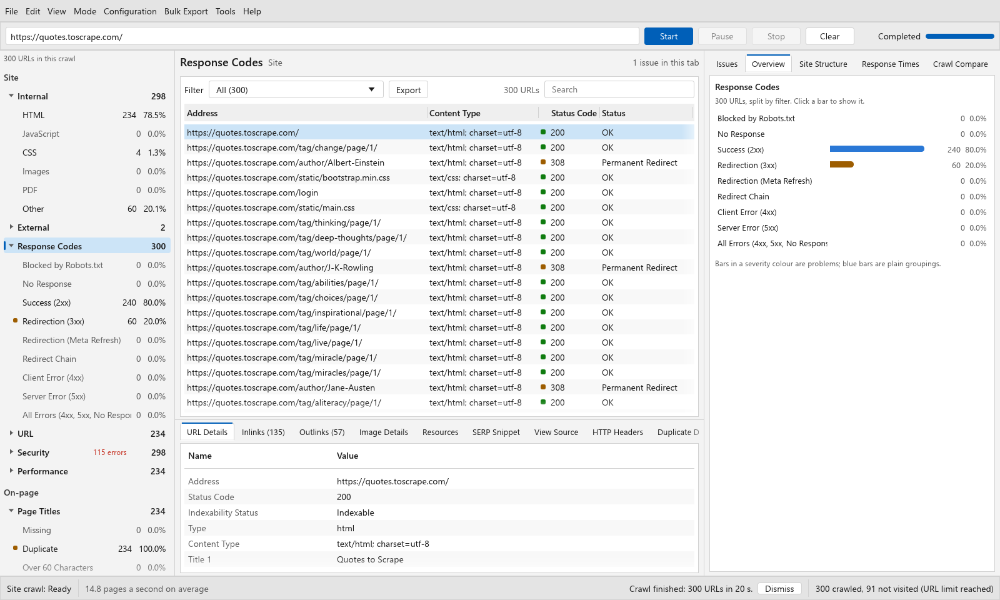
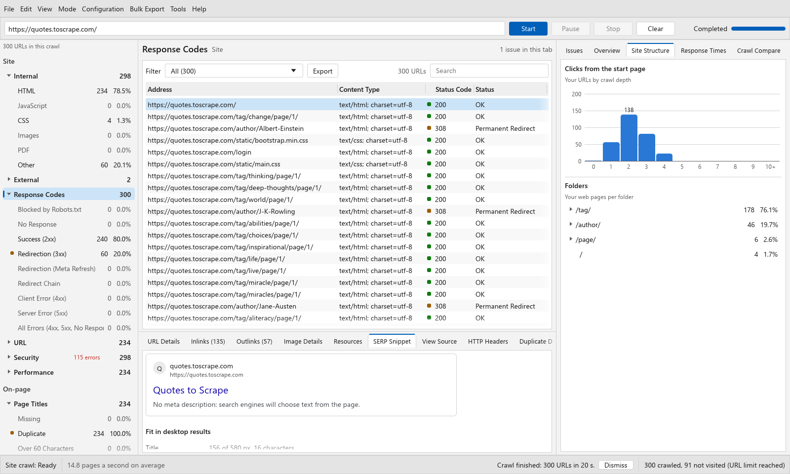
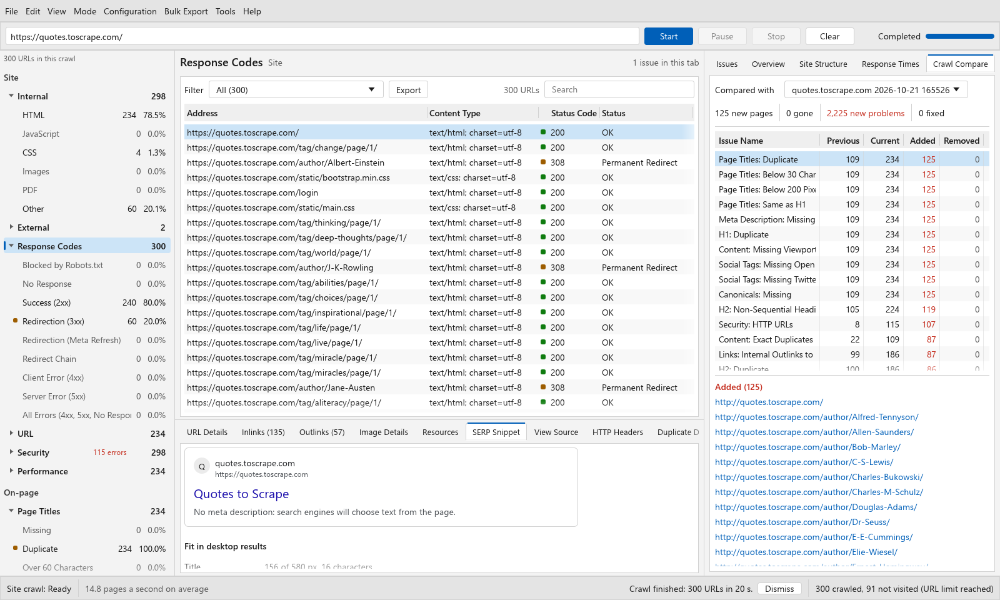
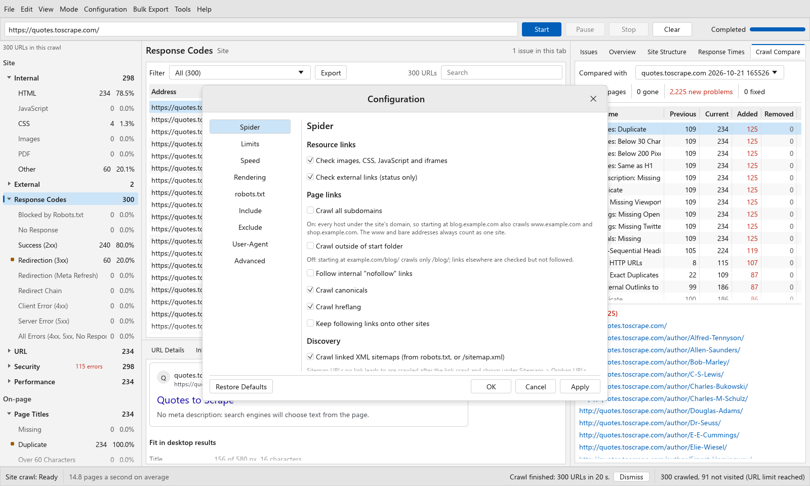
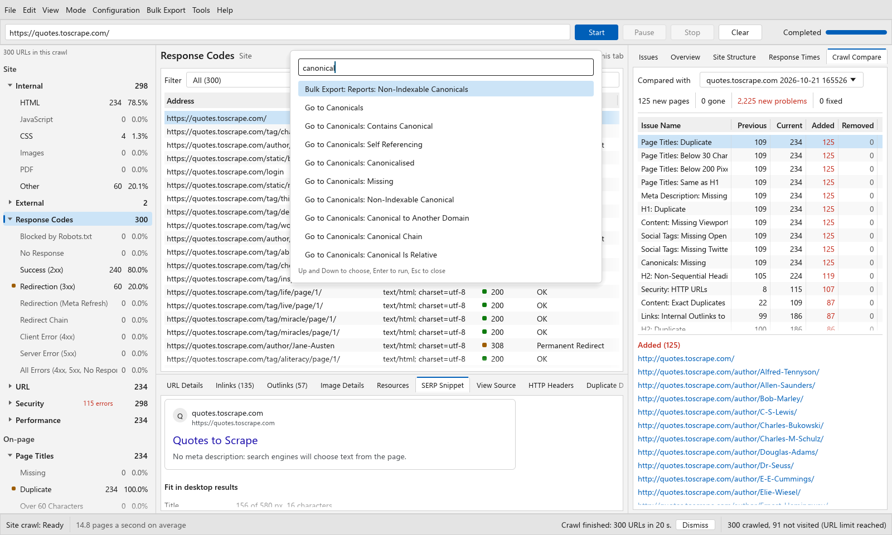
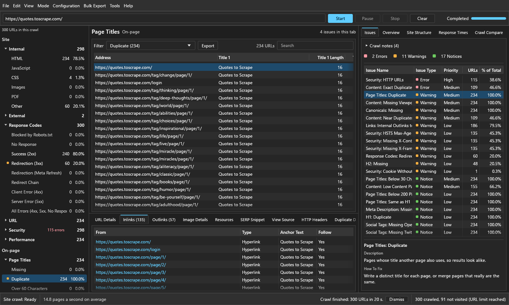
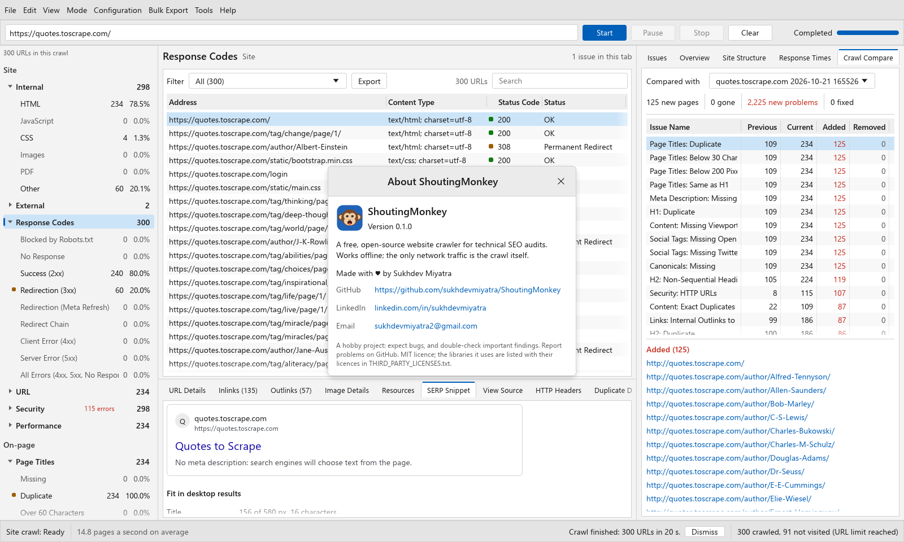

<div align="center">

# ShoutingMonkey

**A free, open-source SEO spider for Windows. A lightweight Screaming Frog alternative in one portable .exe.**

Crawl a website, audit it for 100+ technical SEO issues, see exactly which URLs are affected and how to fix them, and compare crawls over time. No installer, no Java, no URL limit, no account.

[](LICENSE)


[](https://github.com/sukhdevmiyatra/ShoutingMonkey/releases)

[Download](#download) · [Quick start](#quick-start) · [Features](#features) · [How to use it](#how-to-use-it) · [Checks](docs/CHECKS.md) · [Command line and CI](#command-line-and-ci) · [Compared with Screaming Frog](#compared-with-screaming-frog) · [FAQ](#faq)


</div>

> [!WARNING]
> **ShoutingMonkey is a hobby project.** It works well on the sites it has been tested on, but it is young and it has bugs. Double-check important findings before acting on them, and please [report anything that looks wrong](https://github.com/sukhdevmiyatra/ShoutingMonkey/issues). It comes with no warranty (see the [licence](LICENSE)).

## Why ShoutingMonkey

- **One small, portable file.** `ShoutingMonkey.exe` is about 34 MB. Copy it to any Windows PC or a USB stick and double-click it. Nothing to install, no Java runtime, no admin rights.
- **No URL limit, no licence key.** Crawl 50 pages or 500,000. The only limit is your disk.
- **Fast.** Written in Rust, crawling in parallel and saving each crawl to a SQLite file as it goes.
- **Private and offline.** No account, no telemetry, no cloud. The only network traffic is the crawl itself.
- **Explains every issue.** Each of the 107 checks says what it means, how much it matters and how to fix it, with the affected URLs one click away.
- **Built for teams and CI.** Every issue has a stable id, so you can compare crawls ("what broke since last week?") and fail a build when a staging site has errors.

## Download

1. Go to [Releases](https://github.com/sukhdevmiyatra/ShoutingMonkey/releases) and download `ShoutingMonkey.exe`.
2. Double-click it. That's it.

Windows may show a SmartScreen warning because the exe is not code-signed: click **More info → Run anyway**. Prefer to build it yourself? See [Build from source](#build-from-source).

`shoutingmonkey-cli.exe` (also on the Releases page) is the command-line version, for scripts and CI. Most people only need `ShoutingMonkey.exe`.

## Quick start

1. Open `ShoutingMonkey.exe`.
2. Type a website, for example `example.com`, into the address box and press **Start** (or Ctrl+Enter).
3. Watch the progress bar. When it says **Completed**, open **Insights → Issues** on the right. Issues are listed worst first.
4. Click an issue. The table in the middle shows the affected URLs, and the panel below explains the issue and how to fix it.
5. Select a URL to see its details, inlinks, outlinks, images, SERP snippet, source and HTTP headers in the bottom panel.
6. Export anything with **Bulk Export**, or the **Export** button above the table.

Every crawl is saved automatically in `Documents\ShoutingMonkey crawls` and can be reopened from **File → Recent Crawls**.

## Features

**Crawling**
- Follows links, canonicals, hreflang, redirects and meta refresh, the way search engines discover pages.
- Respects robots.txt (or ignores it, or crawls and reports what it would block). Sites without robots.txt or a sitemap crawl normally.
- Reads XML sitemaps and sitemap indexes, and finds orphan URLs that only the sitemap lists.
- Treats `example.com` and `www.example.com` as one site, and picks the main address automatically whichever you type.
- Optional **JavaScript rendering** with the Microsoft Edge or Google Chrome already installed on the PC, for React, Vue, Angular and Next.js sites. Reports links and text that only appear after JavaScript runs.
- **List mode:** check an exact list of URLs instead of crawling.
- Include and exclude URL patterns, crawl depth and URL limits, speed limits, custom user-agents (Googlebot, Bingbot and more).

**Auditing:** 107 issues across 20 tabs, including:
- Response codes (4xx, 5xx, redirects, redirect chains, no response) and broken internal and external links
- Page titles, meta descriptions, H1 and H2 (missing, duplicate, too long or too short, pixel width)
- Canonicals (missing, canonicalised, chains, non-indexable targets, relative URLs)
- Directives (noindex, nofollow and more) and indexability
- XML sitemaps (orphans, non-indexable URLs, errors, lastmod problems)
- Hreflang (invalid codes, missing return links, missing self references)
- Exact duplicate content and near duplicates (SimHash on the main content)
- Images (missing alt text, oversized, missing width and height)
- Security (HTTP pages, mixed content, HSTS, CSP, cookies, insecure forms)
- Structured data, Open Graph, viewport, language, internal linking, crawl depth and link score

The full list, with what each issue means and how to fix it, is in **[docs/CHECKS.md](docs/CHECKS.md)**.

**Analysis**
- **Insights:** Issues (filterable by severity), an overview chart of the current tab, site structure (crawl depth and folders) and response times.
- **Crawl Compare:** compare with an earlier crawl of the same site and see which URLs were added to or removed from each issue.
- **Crawl Tree Graph:** the site's link structure as an interactive graph.
- **Link Score:** a 0–100 PageRank-style score for every page.

**Exports:** the current tab as CSV, all inlinks, outlinks and anchor text, broken-link and redirect reports, redirect chains, image alt text, an issues overview, every issue as its own CSV, XML and image sitemaps, and saved page source.

**Desktop app:** spreadsheet-style tables (resize, fit, sort), a command palette (Ctrl+K) for every action and filter, light and dark themes, a resizable interface, and keyboard shortcuts.

## Screenshots

| | |
|---|---|
|  **Response Codes** with URL Details |  **SERP Snippet**, with title and description pixel widths |
|  **Crawl Compare**: issues added and removed since the last crawl |  **Configuration** |
|  **Command palette** (Ctrl+K) |  **Dark mode** |

## How to use it

The [user guide](docs/USER_GUIDE.md) walks through every part of the app. In short:

- **Navigator (left):** every tab, grouped into Site, On-page, Indexing and Linking. Expand a tab to see its filters (Missing, Duplicate, Over 60 Characters…) and how many URLs each holds. Coloured squares mark issues.
- **Results (centre):** the URLs in the current tab and filter. Click a column heading to sort, drag a column edge to resize, right-click a heading to choose columns, and use Search to filter.
- **Insights (right):** Issues, Overview, Site Structure, Response Times and Crawl Compare.
- **Inspector (bottom):** everything about the selected URL: URL Details, Inlinks, Outlinks, Image Details, Resources, SERP Snippet, View Source, HTTP Headers and Duplicate Details.
- **Configuration menu:** what to crawl (Spider), Limits, Speed, Rendering, robots.txt, Include, Exclude, User-Agent and Advanced.
- **Mode menu:** Spider (crawl a site) or List (check a list of URLs).
- **Command palette (Ctrl+K):** type a few letters of any action, tab or filter, for example `missing title` or `export redirects`.

| Shortcut | Does |
|---|---|
| Ctrl+Enter | Start crawling |
| Ctrl+K | Command palette |
| Ctrl+F | Search the current view |
| Ctrl+C | Copy the selected URL |
| Ctrl+O / Ctrl+S / Ctrl+W | Open, save a copy of, or close a crawl |
| Ctrl+Plus / Ctrl+Minus / Ctrl+0 | Bigger, smaller or default interface size |
| Up / Down, Escape | Move through the table, clear the selection |

## How it crawls

- Starts at the address you give and crawls with 5 parallel requests and no rate limit by default (set one under **Configuration → Speed** for fragile sites). It follows up to 5 redirects per URL.
- Follows links, canonicals, hreflang and meta refresh redirects within the site. External links are checked but not crawled.
- `example.com` and `www.example.com` are one site. If the address you type answers without redirecting but names the other form as its canonical, the crawl moves to that main address (a crawl note says so), so both ways give the same crawl.
- **Crawl all subdomains** covers every host under the registrable domain, using the public suffix list (`blog.example.co.uk` includes `shop.example.co.uk`). Starting inside a folder (`example.com/blog/`) keeps the crawl in that folder unless you allow otherwise.
- robots.txt is obeyed when there is one. A missing robots.txt (404) or one that fails (5xx) blocks nothing. Sitemaps are read from robots.txt or `/sitemap.xml`. Sitemap URLs that no link leads to are crawled after the link crawl, so crawl depths stay true, and are reported as Orphan URLs.
- After the crawl it works out near duplicates and link scores. **Issues → Crawl notes** records what robots.txt and the sitemaps said.

## Command line and CI

```bat
shoutingmonkey-cli crawl https://example.com --max-urls 5000 -o out
shoutingmonkey-cli problems out\crawl.db
shoutingmonkey-cli export out\crawl.db -o exports
shoutingmonkey-cli checks
```

Fail a build when a staging site has errors:

```bat
shoutingmonkey-cli crawl https://staging.example.com --report problems.json --fail-on error
```

The command exits with status 2 when an issue at the given severity or worse is found. The JSON report lists every issue with a stable `id` (the check and the URL), so the same issue keeps the same id from one crawl to the next. Run `shoutingmonkey-cli crawl --help` for every option (depth, speed, include and exclude patterns, JavaScript rendering, robots.txt mode and more).

A GitHub Actions step:

```yaml
- name: SEO check
  shell: pwsh
  run: |
    Invoke-WebRequest https://github.com/sukhdevmiyatra/ShoutingMonkey/releases/latest/download/shoutingmonkey-cli.exe -OutFile sm.exe
    ./sm.exe crawl https://staging.example.com --max-urls 2000 --report seo-issues.json --fail-on error
```

## Compared with Screaming Frog

Screaming Frog SEO Spider is the industry standard and a far more mature product. ShoutingMonkey covers the core technical audit for free, in a much smaller package.

| | ShoutingMonkey | Screaming Frog SEO Spider |
|---|---|---|
| Price | Free and open source (MIT) | Free up to 500 URLs; paid yearly licence beyond that |
| Download | One portable ~34 MB .exe, no installer | Installer; a Java-based desktop app |
| URL limit | None | 500 URLs in the free version |
| JavaScript rendering | Yes (uses your installed Edge or Chrome) | Yes (paid licence) |
| Crawl comparison | Yes, with stable issue ids | Yes (paid licence) |
| Command line and CI | Yes, with an exit code for CI | Yes (paid licence) |
| Google Analytics, Search Console, PageSpeed integrations | No | Yes (paid licence) |
| Custom extraction, spelling and grammar, accessibility audits | No | Yes (paid licence) |
| Platforms | Windows | Windows, macOS, Linux |
| Maturity and support | Hobby project, community support | Commercial product with support |

Feature details for Screaming Frog are based on its public documentation and may change; check their website for current details.

## FAQ

**Is ShoutingMonkey really free?** Yes. It's open source under the MIT licence, with no URL limit, no licence key and no account.

**Does it work offline?** Yes. Apart from the crawl itself it makes no network requests: no telemetry, no update checks, no cloud.

**Does it need Java or an installer?** No. It's a single native Windows executable.

**Does it work on macOS or Linux?** Not yet. The engine is cross-platform Rust, but releases are built and tested for Windows 10 and 11.

**Can it crawl JavaScript sites?** Yes. Turn on **Configuration → Rendering**. It uses the Microsoft Edge or Google Chrome installed on the PC, headless, with a throwaway profile.

**How big a site can it crawl?** There's no built-in limit. Results are written to a SQLite file as the crawl runs, so memory use stays modest. Very large sites take time, so start with a URL limit (**Configuration → Limits**).

**Is it a Screaming Frog clone?** No. It's an independent project written from scratch, with its own code and design. It uses the standard names technical SEO tools share (Response Codes, Page Titles, Canonicals and so on) so it feels familiar.

**Where are my crawls?** In `Documents\ShoutingMonkey crawls`, one folder per crawl. Settings and the log are in `%LOCALAPPDATA%\ShoutingMonkey`. Set the `SHOUTINGMONKEY_HOME` environment variable to keep everything in one folder instead (handy on a USB stick).

## Build from source

You need [Rust](https://rustup.rs). With the GNU toolchain you also need a MinGW C compiler for the bundled SQLite (MSYS2: `pacman -S mingw-w64-x86_64-gcc`); with the MSVC toolchain, Visual Studio's C++ build tools.

```bat
build.bat
```

This writes `ShoutingMonkey.exe`, `shoutingmonkey-cli.exe` and `THIRD_PARTY_LICENSES.txt` to `dist\`.

```bat
cargo test --workspace
```

The test suite includes a local website built to be broken in as many ways as possible: it is crawled with the real crawler, and the test fails if any check that site can trigger does not fire. The desktop UI tests crawl a public scraping sandbox and render the real window offscreen, so they are opt-in:

```bat
set SHOUTINGMONKEY_HOME=%TEMP%\sm-test
cargo test -p gui -- --ignored --test-threads=1
```

### Project layout

| Path | What |
|---|---|
| `crates/engine` | The crawler: frontier, fetching, robots.txt, sitemaps, HTML parsing, JavaScript rendering, the SQLite store, post-crawl analysis and the check catalogue |
| `crates/gui` | The desktop app (egui) |
| `crates/cli` | The command-line app |
| `docs/` | The check reference, user guide and screenshots |
| `tools/` | `third_party_licenses.py`, which writes the licences of every bundled library |

## Contributing

Bug reports, ideas and pull requests are welcome; see [CONTRIBUTING.md](CONTRIBUTING.md). When reporting a crawl bug, include the site (if public), what you expected and what ShoutingMonkey showed.

## Author

Made with ♥ by **Sukhdev Miyatra**

- LinkedIn: [linkedin.com/in/sukhdevmiyatra](https://www.linkedin.com/in/sukhdevmiyatra/)
- Email: [sukhdevmiyatra2@gmail.com](mailto:sukhdevmiyatra2@gmail.com)
- GitHub: [github.com/sukhdevmiyatra/ShoutingMonkey](https://github.com/sukhdevmiyatra/ShoutingMonkey)



## Licence and disclaimer

ShoutingMonkey is released under the [MIT licence](LICENSE). The libraries it is built with are listed with their licences in `THIRD_PARTY_LICENSES.txt`, which ships with every release.

This is a hobby project provided as is, without warranty: it may contain bugs, and its findings should be checked before you act on them. Only crawl sites you own or have permission to crawl, and keep the crawl speed reasonable on sites you don't control.

Screaming Frog and SEO Spider are trademarks of Screaming Frog Ltd. ShoutingMonkey is an independent project and is not affiliated with, endorsed by or connected to Screaming Frog Ltd. Other product names are trademarks of their owners.
