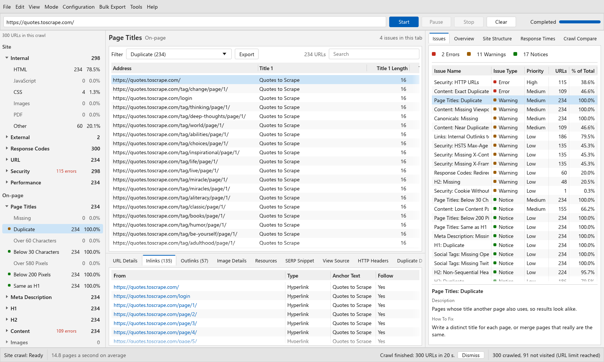

# ShoutingMonkey

> Free, open-source SEO spider for Windows. Crawl a site, find technical issues, and export the results. Built in Rust.

[Website](https://sukhdevmiyatra.github.io/ShoutingMonkey/) · [Download](https://github.com/sukhdevmiyatra/ShoutingMonkey/releases) · [User guide](docs/USER_GUIDE.md) · [Checks](docs/CHECKS.md) · [Report a bug](https://github.com/sukhdevmiyatra/ShoutingMonkey/issues)



ShoutingMonkey is a native Windows desktop crawler for technical SEO work. It is intended for people who want the familiar workflow of a desktop SEO spider without a subscription. It is an independent project and is not affiliated with Screaming Frog.

## Download

Download `ShoutingMonkey.exe` from [Releases](https://github.com/sukhdevmiyatra/ShoutingMonkey/releases). It is portable, so no installer is required.

The release also includes `shoutingmonkey-cli.exe` for scripts and CI. Windows may show a SmartScreen warning because the executable is not code-signed.

## What it covers

- Crawl internal pages, external links, XML sitemaps, canonicals, hreflang, redirects, and meta refreshes
- Audit 107 technical checks across response codes, indexability, titles, descriptions, headings, content, images, security, structured data, and internal linking
- Render JavaScript with an installed copy of Microsoft Edge or Google Chrome when the HTML response is not enough
- Review inlinks, outlinks, headers, page source, resources, image data, SERP snippets, duplicate groups, and crawl notes
- Compare a new crawl with an earlier one to see issues and URLs added or removed
- Export tables, issue reports, links, redirects, sitemaps, and saved HTML
- Run the same crawler from the command line and return a non-zero exit code for a chosen issue severity

See the [check reference](docs/CHECKS.md) for the complete list. See the [user guide](docs/USER_GUIDE.md) for crawl settings, workflow, and exports.

## Command line

```bat
shoutingmonkey-cli crawl https://example.com --max-urls 5000 -o out
shoutingmonkey-cli problems out\crawl.db
shoutingmonkey-cli export out\crawl.db -o exports
```

For CI, fail the command when the crawl finds errors:

```bat
shoutingmonkey-cli crawl https://staging.example.com --report problems.json --fail-on error
```

Run `shoutingmonkey-cli crawl --help` for all options.

## Build from source

Install [Rust](https://rustup.rs). The GNU toolchain also needs a MinGW C compiler for bundled SQLite. The MSVC toolchain needs Visual Studio C++ build tools.

```bat
build.bat
cargo test --workspace
```

The executables and third-party licence notice are written to `dist\`.

## Project status

ShoutingMonkey is a hobby project. Test important findings before acting on them, and only crawl sites you own or are allowed to test. Bug reports and pull requests are welcome. Read [CONTRIBUTING.md](CONTRIBUTING.md) before opening a contribution.

## Licence

ShoutingMonkey is released under the [MIT Licence](LICENSE). Screaming Frog and SEO Spider are trademarks of Screaming Frog Ltd. Other product names are trademarks of their owners.
